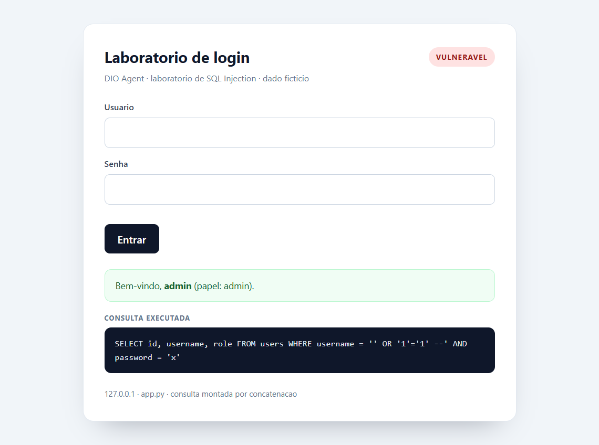
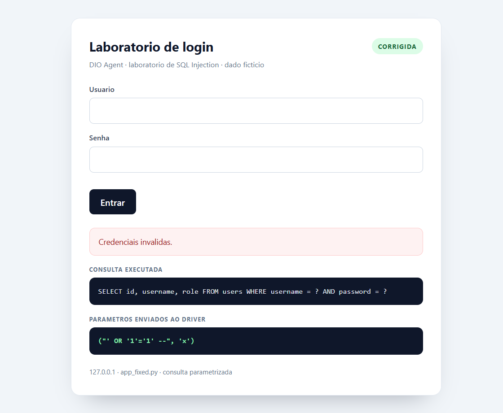

# DIO Agent — análise de vulnerabilidades

[](https://www.python.org/)
[](https://github.com/isaacof/dio-agent-security/actions)
[](#4-demonstração)
[](https://owasp.org/Top10/A03_2021-Injection/)
[](https://dio.me)

Evolução do [DIO Agent](https://github.com/digitalinnovationone/dio-agent) para
um mentor de segurança de aplicação. Em vez de responder direto, o agente
entende o contexto, classifica a falha, mede impacto e probabilidade, orienta a
correção e valida o resultado.

Nada de modelo treinado: o comportamento vem dos arquivos em Markdown.

## 1. A especialização, e por quê

O DIO Agent original é um mentor de estudos: monta plano, destrava desafio,
revisa portfólio. O que faltava era processo para olhar código inseguro. Sem
processo, a resposta tende a ser genérica — "use consulta parametrizada" — e
vem antes de saber onde o código roda.

A mesma falha muda de gravidade conforme o contexto:

- SQL Injection num script local de estudo é um exercício;
- o mesmo SQL Injection no login de um servidor exposto, com dado de cliente,
  é incidente com prazo.

A especialização tem três partes:

| Parte | Arquivo | Papel |
|---|---|---|
| **Processo** | [`skills/vulnerability-analysis/SKILL.md`](skills/vulnerability-analysis/SKILL.md) | Sete etapas fixas, do contexto à validação |
| **Vocabulário** | [`agent/knowledge/security-basics.md`](agent/knowledge/security-basics.md) | Vulnerabilidade × ameaça × risco, tríade CIA, superfície de ataque, projeto seguro |
| **Postura** | [`agent/persona.md`](agent/persona.md) e [`AGENTS.md`](AGENTS.md) | Investigar antes de opinar, falar em evidência, calibrar risco |

### A skill em sete etapas

| # | Etapa | Saída |
|---|---|---|
| 1 | Enquadrar o alvo | Onde roda, quem alcança, quais dados toca |
| 2 | Reunir evidência | Trecho, configuração, versões, erro |
| 3 | Identificar e classificar | CWE, MITRE ATT&CK, OWASP Top 10 |
| 4 | Avaliar | Impacto, probabilidade e severidade por matriz |
| 5 | Explicar a exploração | Payload mínimo e o que a falha **não** permite |
| 6 | Orientar a correção | Causa raiz, correção mínima, defesa em profundidade |
| 7 | Validar | Repetir o payload, rodar o teste, procurar o mesmo padrão |

A skill define perguntas, ordem e formato. O conteúdo sai do código que o
estudante enviar — não há resposta pronta nela.

## 2. A melhoria escolhida

Entre as ideias sugeridas, escolhi **fazer a análise sair sempre no mesmo
formato**, com impacto, probabilidade e severidade. Sem formato fixo, dois
casos analisados no mesmo dia saem incomparáveis: um vira parágrafo, o outro
vira lista, e ninguém consegue priorizar.

| Impacto \ Probabilidade | Alta | Média | Baixa |
|---|---|---|---|
| **Alto** | Crítica | Alta | Média |
| **Médio** | Alta | Média | Baixa |
| **Baixo** | Média | Baixa | Informativa |

A skill também declara o prazo sugerido por severidade: Crítica e Alta antes de
produção; Média na próxima janela; Baixa e Informativa no backlog. É o gancho
para DevSecOps — a mesma ficha aplicada a cada alteração antes do deploy.

## 3. Como rodar

### Com Hermes

Instale o Hermes conforme a documentação oficial:
https://hermes-agent.nousresearch.com/docs

Depois, sempre **na pasta do projeto** — é isso que faz o agente encontrar
`AGENTS.md`, a persona, o conhecimento e as skills:

```bash
git clone https://github.com/isaacof/dio-agent-security.git
cd dio-agent-security
hermes
```

Se abrir o Hermes em outra pasta, ele não vê estes arquivos e responde como um
chat comum.

### Com outro harness

Qualquer harness que leia `AGENTS.md` funciona: Claude Code, Codex, OpenCode,
Antigravity. Abra a pasta do projeto e converse.

### Conversa de exemplo

```text
Analise o demo/app.py como especialista em AppSec.
Quero entender a falha, o impacto e como corrigir.
```

O esperado é o agente perguntar o contexto antes de sugerir qualquer coisa.

## 4. Demonstração

O laboratório tem duas versões do mesmo login, em Python puro (biblioteca
padrão), rodando em `127.0.0.1` com banco temporário e usuários fictícios.

| Versão vulnerável | Mesmo payload, versão corrigida |
|---|---|
|  |  |
| A consulta exibida contém o payload: `WHERE username = '' OR '1'='1' --'` | A consulta continua com `?`; o payload aparece só como parâmetro |

A página mostra a consulta executada de propósito: o print vira prova, não
ilustração.

### Teste automatizado

```bash
cd demo
python verify.py
```

```text
[credencial valida]        app.py 200 | app_fixed.py 200
[senha errada]             app.py 401 | app_fixed.py 401
[bypass OR 1=1]            app.py 200 | app_fixed.py 401
[comentario apos usuario]  app.py 200 | app_fixed.py 401
[bypass no campo senha]    app.py 200 | app_fixed.py 401

RESULTADO: comportamento esperado nos 5 casos
```

O teste confere status **e** corpo da resposta, para não dar "OK" a um 200 com
página de erro. Roda também no GitHub Actions a cada push.

### Evidências

| Artefato | O que mostra |
|---|---|
| [`demo/evidence/agent_session.md`](demo/evidence/agent_session.md) | Conversa real com o agente: perguntas de contexto, análise e validação |
| [`demo/evidence/verify_output.txt`](demo/evidence/verify_output.txt) | Saída completa do teste |
| [`docs/relatorio-sqli.md`](docs/relatorio-sqli.md) | Relatório no formato padrão da skill |
| [`demo/evidence/img/`](demo/evidence/img/) | Capturas de tela do laboratório |

### O contraste que a skill faz

A mesma pergunta foi enviada a um chat genérico, sem `AGENTS.md`, sem persona e
sem a skill:

| Aspecto | Com a skill | Chat genérico |
|---|---|---|
| Primeira ação | Leu o código e pediu contexto em três blocos | Entregou a análise completa de imediato |
| Risco | Impacto Alto × Probabilidade Baixa = Média, com prazo | Descreveu impacto, sem matriz e sem prazo |
| Exploração | Um payload mínimo, com o que a falha não permite | Bypass, `UNION` e time-based de uma vez |
| Correção | Causa raiz, correção mínima, defesa em profundidade | Lista de cinco itens, incluindo trocar o framework |
| Validação | Propôs teste e pediu confirmação | Não pediu validação |
| Fechamento | Perguntou o que o estudante aprendeu | Encerrou na resposta |

O chat genérico não errou o diagnóstico. Errou o processo: tratou como produção
um arquivo de laboratório, entregou três vetores de uma vez e não mediu risco.

## 5. Resultado da análise

| Campo | Valor |
|---|---|
| Falha | SQL Injection na autenticação, por concatenação de string |
| CWE | CWE-89 |
| OWASP Top 10 | A03:2021 Injection |
| MITRE ATT&CK | T1190 só se a aplicação estiver exposta; em `127.0.0.1` não se aplica |
| Impacto | Alto em potencial; baixo no material atual, que é fictício |
| Probabilidade | Baixa no laboratório |
| Severidade | Média (Alto × Baixa); Crítica se o padrão for reutilizado em serviço exposto |
| Prazo sugerido | Antes de reutilizar o padrão em outro projeto |
| Correção | Consulta parametrizada, com defesa em profundidade |
| Validação | `verify.py` confirma os cinco casos |

O raciocínio completo está em [`docs/relatorio-sqli.md`](docs/relatorio-sqli.md).

## 6. Arquivos criados e alterados

| Arquivo | Tipo | O que faz |
|---|---|---|
| `skills/vulnerability-analysis/SKILL.md` | criado | O roteiro que o agente segue |
| `skills/vulnerability-analysis/README.md` | criado | Explica a skill para pessoas |
| `agent/knowledge/security-basics.md` | criado | Base conceitual de segurança |
| `agent/persona.md` | alterado | Seção **Modo AppSec** |
| `AGENTS.md` | alterado | Linha na tabela, item na base, regra 10 e limite de ambiente |
| `demo/app.py` | criado | Login vulnerável, com a consulta exibida na página |
| `demo/app_fixed.py` | criado | Login com consulta parametrizada |
| `demo/verify.py` | criado | Verificação automatizada por HTTP |
| `demo/README.md` | criado | Guia do laboratório |
| `demo/evidence/` | criado | Conversa, saída do teste e capturas |
| `docs/relatorio-sqli.md` | criado | Relatório no formato da skill |
| `.github/workflows/verify.yml` | criado | CI que roda a verificação a cada push |
| `README.md` | alterado | Este arquivo |

## 7. Estrutura do repositório

```text
dio-agent/
├── AGENTS.md                     definição do agente (lida pelo harness)
├── agent/
│   ├── persona.md                personalidade, com a seção Modo AppSec
│   └── knowledge/
│       ├── dio-platform.md
│       ├── learning-experiences.md
│       └── security-basics.md    vocabulário de segurança
├── skills/
│   ├── vulnerability-analysis/
│   │   ├── SKILL.md
│   │   └── README.md
│   ├── study-plan/
│   ├── unblock-challenge/
│   ├── explain-concept/
│   ├── web-search/
│   ├── portfolio-review/
│   └── ai-builder-path/
├── demo/
│   ├── app.py
│   ├── app_fixed.py
│   ├── verify.py
│   ├── README.md
│   └── evidence/
│       ├── agent_session.md
│       ├── verify_output.txt
│       └── img/
├── docs/
│   ├── glossary.md
│   ├── youcom-mcp.md
│   └── relatorio-sqli.md
└── .github/workflows/verify.yml
```

## 8. Skills disponíveis

| Skill | Para que serve | Arquivo |
|---|---|---|
| Análise de vulnerabilidade | Analisa falha, risco e correção com contexto | [`skills/vulnerability-analysis/SKILL.md`](skills/vulnerability-analysis/SKILL.md) |
| Plano de estudos | Organiza o que estudar, em que ordem e em quanto tempo | [`skills/study-plan/SKILL.md`](skills/study-plan/SKILL.md) |
| Destravar desafio | Conduz até a solução sem entregar a resposta | [`skills/unblock-challenge/SKILL.md`](skills/unblock-challenge/SKILL.md) |
| Explicar conceito | Explica com analogia e exemplo curto | [`skills/explain-concept/SKILL.md`](skills/explain-concept/SKILL.md) |
| Pesquisa na web | Responde com fonte citada o que muda com o tempo | [`skills/web-search/SKILL.md`](skills/web-search/SKILL.md) |
| Revisão de portfólio | Feedback sobre GitHub e portfólio antes da vaga | [`skills/portfolio-review/SKILL.md`](skills/portfolio-review/SKILL.md) |
| Caminho AI Builder | Próximo passo na Carreira AI Builder | [`skills/ai-builder-path/SKILL.md`](skills/ai-builder-path/SKILL.md) |

## 9. Limites

- A skill vale para código e laboratório do próprio estudante.
- O agente não testa sistema de terceiros, não pede credencial e não entrega
  exploit voltado para alvo real.
- O laboratório usa banco local, porta local e usuários fictícios.
- As senhas do laboratório ficam em texto puro de propósito, como segundo
  defeito para um exercício separado.

## 10. Créditos

Projeto base: [digitalinnovationone/dio-agent](https://github.com/digitalinnovationone/dio-agent).
Esta é uma especialização independente, feita para o desafio da DIO.
