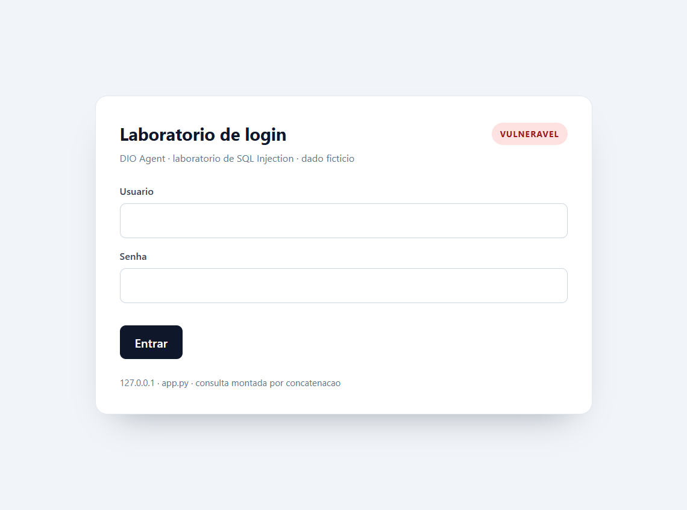
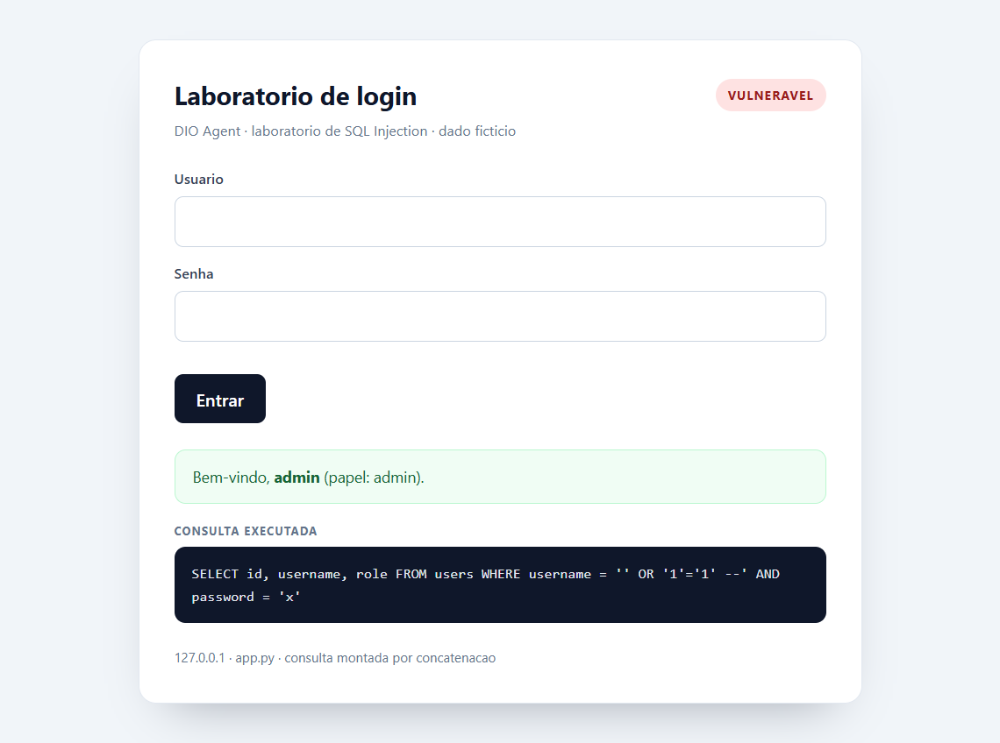
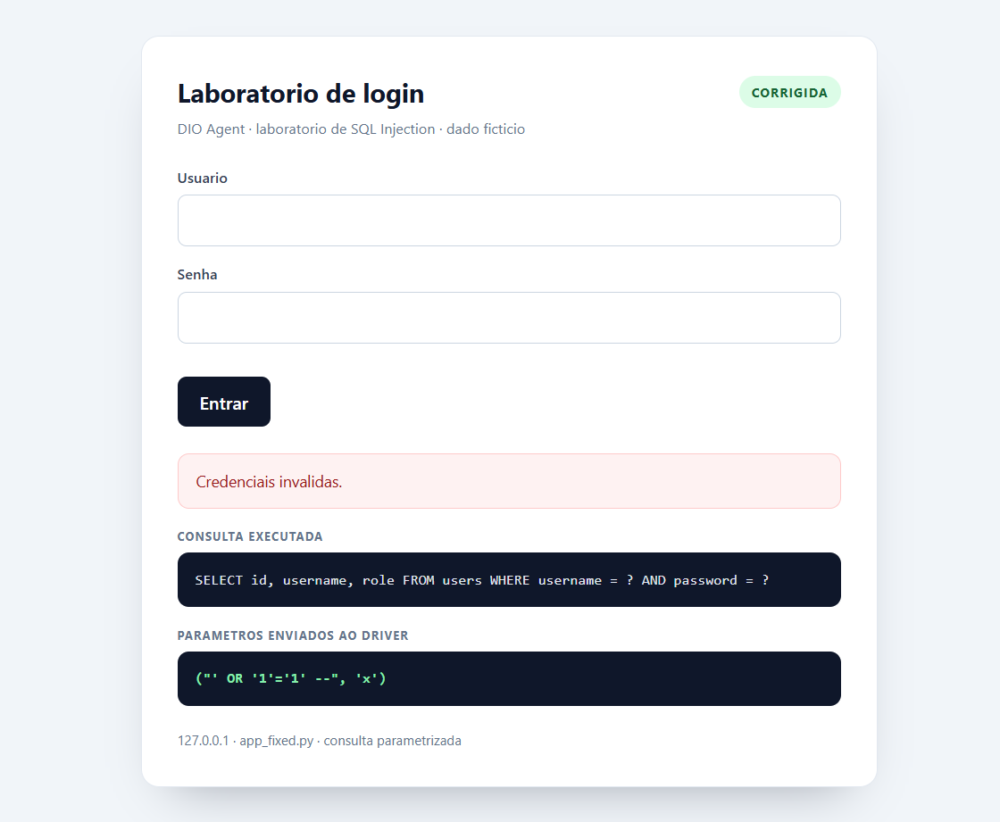

# Laboratório de SQL Injection

Duas versões da mesma tela de login, em Python puro (biblioteca padrão), para
demonstrar na prática a diferença entre consulta concatenada e consulta
parametrizada.

| Arquivo | O que é |
|---|---|
| [`app.py`](app.py) | Versão vulnerável: monta o SQL com o que veio do formulário |
| [`app_fixed.py`](app_fixed.py) | Versão corrigida: consulta parametrizada com `?` |
| [`verify.py`](verify.py) | Sobe as duas em portas efêmeras e compara as respostas |
| [`evidence/verify_output.txt`](evidence/verify_output.txt) | Saída real da verificação |

## O que a falha é

Em `app.py`, a autenticação monta a consulta assim:

```python
query = (
    "SELECT id, username, role FROM users "
    f"WHERE username = '{username}' AND password = '{password}'"
)
conn.execute(query)
```

O conteúdo digitado no formulário entra na string antes de o banco interpretar.
Qualquer trecho com aspas, `OR` ou `--` passa a fazer parte do comando.

A falha é classificada como **CWE-89 (SQL Injection)**. No MITRE ATT&CK, o
caminho de exploração externo é **T1190 (Exploit Public-Facing Application)**.
No OWASP Top 10, cai em **A03: Injection**.

## O que a correção muda

`app_fixed.py` mantém a consulta fixa e envia os valores separados:

```python
conn.execute(
    "SELECT id, username, role FROM users WHERE username = ? AND password = ?",
    (username, password),
).fetchone()
```

O driver trata cada valor como dado, não como comando. Aspas e comentários
deixam de ter efeito sobre a estrutura da consulta.

## Como rodar

```bash
cd demo
python verify.py
```

Saída esperada nos cinco casos:

```text
[credencial valida]        app.py 200 | app_fixed.py 200
[senha errada]             app.py 401 | app_fixed.py 401
[bypass OR 1=1]            app.py 200 | app_fixed.py 401
[comentario apos usuario]  app.py 200 | app_fixed.py 401
[bypass no campo senha]    app.py 200 | app_fixed.py 401
```

O teste confere status **e** corpo da resposta, para não dar "OK" a um 200 com
página de erro.

Para abrir cada versão no navegador:

```bash
python app.py --port 8000
python app_fixed.py --port 8001
```

O banco `lab.db` é criado na primeira execução, com três usuários fictícios.

## Capturas

| Tela | Arquivo |
|---|---|
| Login da versão vulnerável |  |
| Bypass aceito, com a consulta montada visível |  |
| Mesmo payload recusado na versão corrigida |  |

As páginas exibem a consulta executada logo abaixo do resultado. Na versão
vulnerável, o payload aparece dentro do SQL; na corrigida, ele aparece apenas
como parâmetro. É o que transforma a captura em evidência.

## Limites do laboratório

- Roda só em `127.0.0.1`, com banco local e dado fictício.
- As senhas ficam em texto puro de propósito: é um segundo defeito, deixado
  para um exercício separado de hashing e verificação.
- Não há sessão, cookie nem MFA. O objetivo é isolar uma falha por vez.
- O `verify.py` não testa produção, só as duas cópias locais.

## O que observar na análise do agente

Com a skill [`vulnerability-analysis`](../skills/vulnerability-analysis/SKILL.md)
instalada, o agente não começa pela correção. Ele pergunta onde o código roda,
quem consegue alcançar e quais dados protege — porque a severidade depende
disso. A transcrição está em
[`evidence/agent_session.md`](evidence/agent_session.md).
